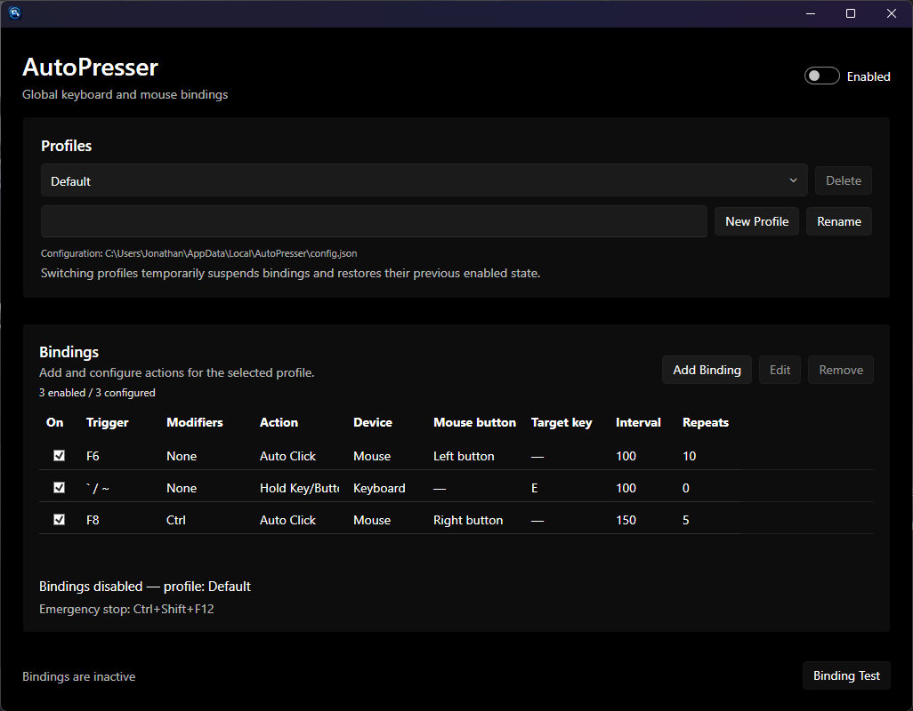
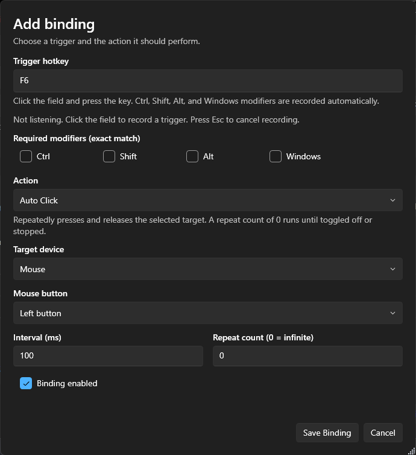

# AutoPresser

AutoPresser is a Windows app to automatically click a selected mouse button or keyboard key, or hold an input until the binding is toggled off.

## Screenshots

### Main window



### Binding editor



## Features

- **Global hotkeys:** Trigger bindings while AutoPresser is not the foreground window.
- **Auto Click:** Repeatedly send a configured mouse-button or keyboard-key press at a chosen interval.
- **Hold:** Hold a configured mouse button or keyboard key until the binding is toggled off or stopped.
- **Hotkey combinations:** Configure triggers with Ctrl, Shift, Alt, and Windows modifiers.
- **Key recorder:** Record a trigger combination by pressing the desired keys in the editor.
- **Multiple profiles:** Keep different sets of bindings for different workflows.
- **Per-binding enablement:** Enable or disable individual bindings.
- **Emergency stop:** Press **Ctrl + Shift + F12** to stop active actions and leave bindings disabled.
- **System theme support:** The interface follows the Windows theme where supported.

## Download

Download the latest `AutoPresser-win-x64.zip` from the project's [GitHub Releases](../../releases) page.

1. Download and extract the ZIP.
2. Run `AutoPresser.exe`.
3. Configure your bindings and leave the master **Toggle Bindings** switch disabled until you're ready to use them.
4. Enable bindings when you want the configured hotkeys to be active.

The release is intended to be self-contained for Windows x64 and should not require a separate .NET desktop runtime installation.

### Windows security warning

Official releases are currently **unsigned**. Windows SmartScreen or other security software may show a warning when you download or run the application. This is expected for an unsigned app from a publisher without established download reputation; it is not, by itself, proof that the file is malicious.

Only download releases from this project's official GitHub Releases page. Review the source code or build the application yourself if you want to verify what you're running.

## Creating bindings

Each binding has a trigger hotkey and an action.

### Auto Click

Auto Click repeatedly presses and releases the selected target.

- Choose a keyboard key or mouse button as the target.
- Set the interval in milliseconds.
- Set the repeat count. A repeat count of **0** means repeat indefinitely, until the binding is toggled off or stopped.

### Hold

Hold presses the selected target and keeps it down. It does not repeatedly send key-down events. Toggle the binding off or use the emergency stop to release the held input.

### Trigger modifiers

A trigger can include **Ctrl**, **Shift**, **Alt**, and/or the **Windows** key. Modifier matching is exact: the configured combination must match the modifiers pressed with the trigger.

Avoid assigning the same trigger combination to multiple bindings. The app validates bindings and reserves **Ctrl + Shift + F12** for the emergency stop.

## Profiles and configuration

AutoPresser stores its configuration in:

`%LOCALAPPDATA%\AutoPresser\config.json`

The file contains the saved profiles and their bindings. Back up this file before manually editing it. Invalid configuration may prevent settings from loading correctly.

Switching profiles temporarily suspends bindings and restores the prior master-enabled state afterward. Opening the add/edit binding dialog also temporarily suspends bindings while the dialog is open.

## Building from source

### Requirements

- Windows
- .NET 10 SDK
- A Windows-compatible IDE such as JetBrains Rider or Visual Studio

### Build

From the repository root, run in PowerShell 7 (`pwsh`):

```powershell
dotnet build .\AutoPresser\AutoPresser.csproj --configuration Release
```

To publish a self-contained Windows x64 build:

```powershell
dotnet publish .\AutoPresser\AutoPresser.csproj `
  --configuration Release `
  --runtime win-x64 `
  --self-contained true `
  --output .\artifacts\publish `
  -p:PublishSingleFile=true `
  -p:IncludeNativeLibrariesForSelfExtract=true `
  -p:DebugType=None `
  -p:DebugSymbols=false
```

## Automated releases

The GitHub Actions workflow in `.github/workflows/release.yml` builds the application on pushes, pull requests, and manual runs. It uploads a ZIP artifact for the workflow run.

To publish a GitHub Release, push a version tag, for example:

```powershell
git tag v1.0.0
git push origin v1.0.0
```

## Limitations and safety notes

- AutoPresser sends simulated input. Some applications, games, anti-cheat systems, remote desktop sessions, or elevated applications may ignore or restrict it.
- Global hotkey behavior can vary by application and Windows configuration.
- Use automation responsibly and follow the rules of the software where you use it.
- The application starts with bindings disabled so they do not begin running unexpectedly after launch.

## License

No license has been specified in this repository yet. Unless a license file is added, the default copyright rules apply and others should not assume they have permission to redistribute or modify the project.
